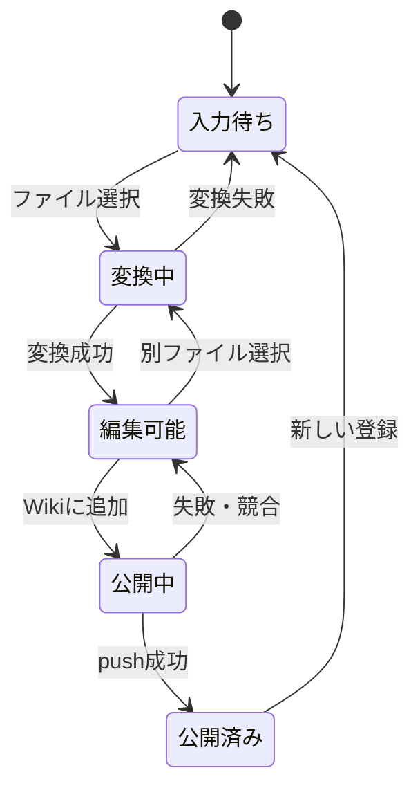

# 基本設計書：画面・機能・データ

[概要設計書](概要設計書.md)の MVP を画面と機能に分解する。処理手順と API 契約は[詳細設計書](詳細設計書.md)を参照する。

## 1. 画面設計

単一画面で次の順に操作する。変換結果を確認するまで公開ボタンを有効にしない。

| 領域 | 入力・表示 | 動作 |
| --- | --- | --- |
| 公開先 | GitHub `owner/repository` | 必須。形式を検査し、画面内に保存しない。 |
| ファイル | `.md` / `.pdf` / `.docx` / `.xlsx` / `.pptx` 1 件 | 選択後に変換を開始する。20 MiB 超は拒否。 |
| ページ名 | 1 行テキスト | ファイル名から初期値を作る。利用者が変更できる。 |
| 本文 | Markdown 編集欄 | 抽出・読込結果を編集できる。 |
| プレビュー | Markdown の表示結果 | 編集中の本文に合わせて更新する。HTML は安全化して描画する。 |
| 警告 | 文字抽出が少ない PDF、相対リンクなど | 公開前に確認できる位置へ表示する。 |
| 公開操作 | 「Wiki に追加」 | 入力有効・変換成功・公開処理中でない場合のみ押せる。 |
| 結果 | 成功 URL・コミット ID、またはエラー | 成功時に Wiki を開くリンクを出す。 |

公開中は再操作を抑止する。プッシュ結果が不明な通信断では、再送前に対象 Wiki 上のページの有無を確認するよう促す。

## 2. 機能一覧

| ID | 機能 | 入力 | 出力・主な失敗 |
| --- | --- | --- | --- |
| F-01 | 対象 Wiki 指定 | `owner/repository` | 正規化した owner/repository。形式不正は拒否。 |
| F-02 | ファイル検査 | ファイル名、内容、サイズ | 許可された種別と上限を検査。拡張子だけで判定しない。 |
| F-03 | PDF 抽出 | PDF バイト列 | ページ順の Markdown。暗号化・破損・画像のみは拒否。 |
| F-04 | Markdown 読込 | `.md` バイト列 | UTF-8 本文。復号不能・空本文は拒否。 |
| F-07 | Office 抽出 | `.docx` / `.xlsx` / `.pptx` バイト列 | テキストと基本構造を Markdown 化。破損・暗号化・空本文は拒否。 |
| F-05 | 編集・プレビュー | ページ名、本文 | 安全化済みプレビュー、警告。 |
| F-06 | 新規ページ公開 | 対象 Wiki、ページ名、本文 | Git commit/push、URL、コミット ID。認証・衝突・競合を区別する。 |

## 3. 入力・出力ルール

### 3.1 ファイル

- ブラウザの `accept` 属性は操作補助とし、サーバーでも拡張子と内容を検査する。
- PDF は `%PDF-` ヘッダーと PDF パーサーで検証する。ページ数 1〜100。抽出文字を前後の空白除去後に判定し、全文が空なら拒否する。
- Markdown は UTF-8（BOM 付きも許可）で読む。NUL 文字を含むもの、空白だけのものは拒否する。
- Office は OOXML の ZIP と主要 XML を検査する。展開後 50 MiB または 2000 項目を超えるものは拒否する。画像・図形・グラフ・コメント・書式は移送しない。
- 初版はテキストを扱う。PDF の画像・表・脚注・複雑な段組みは完全には再現されない。
- Markdown の相対リンク・相対画像 URL は公開先で参照先が変わる可能性があるため、参照先ごとに警告する。編集後も警告を更新する。添付ファイルは自動移送しない。

### 3.2 ページ名

- ファイル名の拡張子を除いた部分を初期値とし、利用者に最終確認させる。
- 1〜100 文字、前後の空白なし、`.` / `..` のみ不可。制御文字、`/`、`\\`、`: * ? \" < > |`、末尾の `.`、予約名 `Home` / `_Sidebar` / `_Footer`（大文字小文字を区別しない）を拒否する。
- タイトルを Unicode NFC に正規化し、最終ファイル名を `<タイトル>.md` とする。リポジトリ内の既存ファイルとは、Unicode NFC と大文字小文字をそろえた名前で衝突判定する。
- ファイル名がページ名を決めること、および GitHub が避けるよう指定する文字は公式文書に従う：[GitHub Docs: About wiki filenames](https://docs.github.com/en/communities/documenting-your-project-with-wikis/adding-or-editing-wiki-pages#about-wiki-filenames)。

### 3.3 本文

- 改行を LF に正規化し、UTF-8 で保存する。空白だけの本文は拒否する。
- Markdown 入力は元の構造をできるだけ維持する。PDF は `## PDF 1ページ目` のような見出しと抽出本文を置く。ページ番号は元 PDF の順番を表す。ページ名は Wiki のファイル名で決める。
- Markdown 内の HTML は保存され得るため、プレビューは HTML サニタイズを適用する。公開先での GitHub による表示は GitHub の処理に従う。

## 4. 状態と遷移

変換と公開は別操作であり、変換だけでは GitHub に変更を送らない。

### PR 審査を通す公開経路

CLI で入力書類を `wiki-pages/<ページ名>.md` に変換し、通常リポジトリの PR で本文を審査する。PR の検証は新規追加のみを許可する。`main` へのマージ後、GitHub Actions がその push で追加されたページだけを Wiki の Git リポジトリへ登録する。PR 中に Wiki への書き込みは行わない。既存ページの変更・削除はこの経路の対象外とする。

画面の標準操作も `POST /api/stage` による審査用 Markdown 保存とする。`POST /api/publish` の直接公開は環境変数 `ALLOW_DIRECT_WIKI_PUBLISH=1` の時だけ許可する。

PR 審査を必須にするには GitHub 側で `main` に PR 必須・承認必須・検証チェック必須のルールセットを設定する。ワークフロー単体では直接 push を防げない。

ファイル変換とプレビューの応答順が入れ替わっても、画面には最後に選んだファイルと最後に編集した本文の結果だけを反映する。

## 5. 公開先との関係

- GitHub Wiki は通常のコードリポジトリとは別の `.wiki.git` リポジトリを持つ。アプリはそのデフォルトブランチに追加した Markdown をプッシュする。[GitHub Docs: Adding or editing wiki pages](https://docs.github.com/en/communities/documenting-your-project-with-wikis/adding-or-editing-wiki-pages)。
- 公開先の URL は `https://github.com/<owner>/<repository>/wiki/<URL エンコードしたページ名>` とする。URL の最終的な表現は GitHub 側で変わる可能性があるため、画面には Wiki トップへのリンクも併記する。
- 同名ファイルが存在する場合は公開不可。別ページへのリンク、サイドバー、ホームは自動変更しない。
- Wiki が無効または未初期化の場合は、GitHub 上で Wiki を有効化し初期ページを作る手順を表示する。

## 6. 運用・非機能

| 観点 | 設計 |
| --- | --- |
| 配置 | ローカル PC。サーバーは `127.0.0.1` にバインドする。 |
| 認証 | Git CLI の既存設定を利用。ブラウザやアプリ設定にトークンを保存しない。 |
| 一時データ | アップロードと Wiki クローンは OS の一時ディレクトリに置き、要求終了時に削除。 |
| 機密情報 | 本文、PDF 原本、Git リモートの資格情報をアプリログに出さない。 |
| 応答 | 変換・公開中は進行状態を示す。長時間処理の上限・キャンセル方法は詳細設計で定義する。 |
| 障害 | 失敗の種類を UI に示す。ネットワーク断や競合は再試行できる状態へ戻す。 |

## 7. 受け入れ確認

| ケース | 期待結果 |
| --- | --- |
| UTF-8 Markdown | 編集後の本文で新規ページを公開できる。 |
| 文字を含む複数ページ PDF | 元のページ順で見出し付き本文になる。 |
| 画像だけの PDF | 空の Wiki ページを作らず、OCR 非対応を案内する。 |
| 同名ページ | 既存ページを変更せず、ページ名の変更を求める。 |
| 公開中のリモート更新 | 非 fast-forward を検出し、既存データを上書きしない。 |
| 認証失敗・通信失敗 | 原因を表示し、入力と編集内容を画面に保持する。 |
