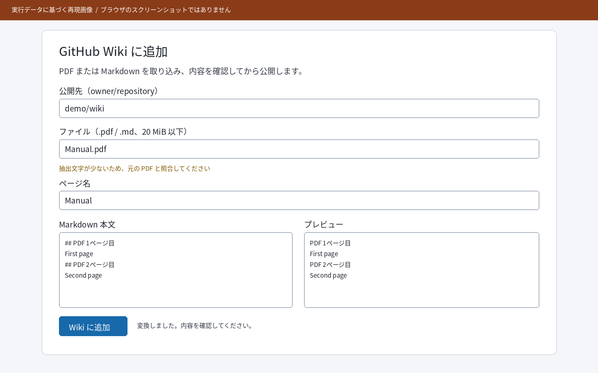
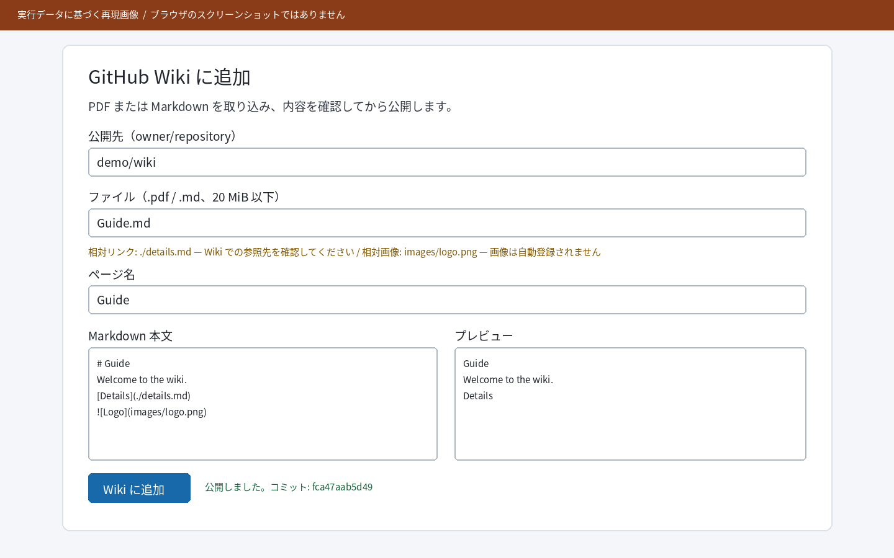
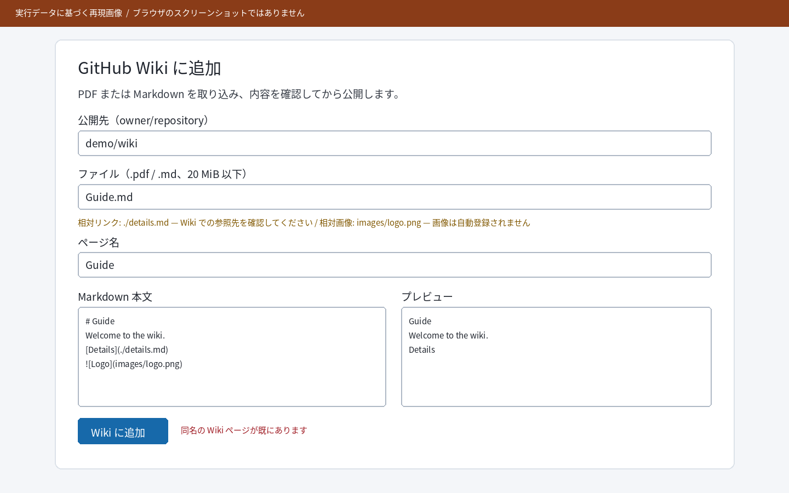

# GitHub Wiki Importer

### 実働確認レポート

| 文書情報 | 内容 |
| :--- | :--- |
| 確認日 | 2026-10-19 |
| 対象 | ローカル Web アプリ / PDF・Markdown の GitHub Wiki 登録 |
| 実行先 | プロセス内 ASGI + 一時ローカル Git Wiki |
| 総合結果 | 実行した範囲で成功。実ブラウザと GitHub 本番は未確認 |

> **判定:** プロセス内の画面配信・変換・プレビュー・ローカル Git 公開は成功。ブラウザ撮影と GitHub 実環境への公開は未確認。

---

## 01｜確認方法と範囲

アプリの ASGI インターフェースをプロセス内で実行した。`GET /`、`.md` と PDF の変換・プレビュー、ローカルの一時 Git Wiki への公開、同名ページの拒否を連続して確認した。画面側は別途 Node.js のヘッドレス DOM テストで操作フローを確認した。

**図1〜4は API の実行データを画面の配置に当てはめた再現画像であり、実ブラウザのスクリーンショットではない。** この実行環境ではローカルソケット作成が拒否され、Chrome と Firefox も起動できないため、実ブラウザ撮影は行えていない。画像に見える `demo/wiki` はテスト用のローカル Git リポジトリに接続した値で、GitHub へは送信していない。

| 確認項目 | 実測結果 |
| :--- | :--- |
| 画面配信 | `GET /` → HTTP 200 |
| Markdown 取り込み | `POST /api/convert` → HTTP 200 |
| PDF 取り込み | `POST /api/convert` → HTTP 200 |
| 新規ページ公開 | `POST /api/publish` → HTTP 201、保存本文一致: `true` |
| 同名ページ再公開 | `POST /api/publish` → HTTP 409 / `PAGE_EXISTS` |

---

## 02｜Markdown の取り込み

`Guide.md` を取り込み、本文と相対リンク・画像の警告を取得した。プレビューは `POST /api/preview` の結果を使用した。

*図1　Markdown 取り込み。相対参照の警告は実際の API 応答を表示。ブラウザ撮影ではない。*

---

## 03｜PDF の取り込み

2 ページのテキスト PDF `Manual.pdf` を入力した。変換結果には `PDF 1ページ目` と `PDF 2ページ目` の見出し、および `First page`・`Second page` の本文がこの順に含まれた。

*図2　PDF 取り込み。画面内の本文・プレビューは実際の変換結果に基づく。ブラウザ撮影ではない。*

---

## 04｜Wiki への追加と重複保護

`Guide.md` の変換本文を、一時的に作ったローカル Git Wiki に新規追加した。プッシュ後に Wiki を取得し直し、保存本文が送信した Markdown と完全一致することを確認した。コミット ID は `fca47aab5d49`。

*図3　公開成功時。結果リンクはアプリが組み立てた URL であり、この確認では GitHub 上にページは作成していない。*

同じページ名を再度公開すると、HTTP 409 と `PAGE_EXISTS` が返った。

*図4　同名ページの公開拒否。既存本文は変更されていない。*

---

## 05｜検証結果と残る確認

- Python 自動テスト: `uv run python -m pytest -q` → **55 件成功**。
- 画面スクリプトのヘッドレス DOM テスト: `node tests/test_ui.mjs` → **7 件成功**。
- 実ポートへのサーバー起動: `127.0.0.1:8000` への bind が環境に拒否されたため未確認。
- 実ブラウザのスクリーンショット: 未取得。図1〜4は再現画像。
- 実 GitHub Wiki への公開: 利用者の指定に従い、今回は行っていない。

実行の機械可読な記録は [demo_run.json](evidence/demo_run.json) に保存した。再現手順は `uv run python -m scripts.build_demo_report`。設計とタスクの状態は [タスク一覧](tasks_1.md) を参照。
